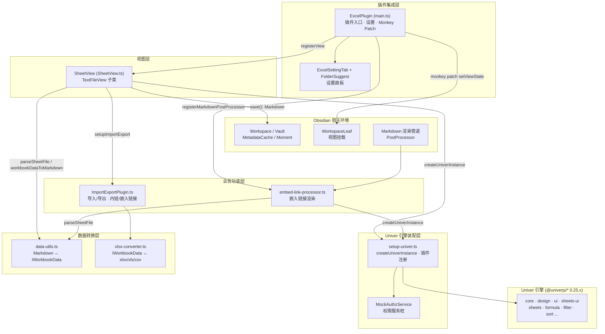
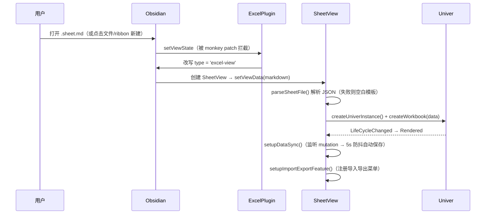
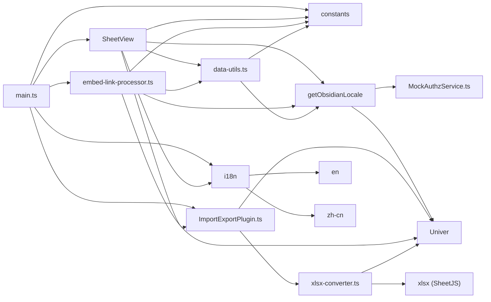

# Code Wiki — obsidian-excel-lite (Excel Lite)

> 基于 [Univer](https://univer.ai) 的 Obsidian 电子表格插件，支持 `.xlsx` / `.xls` / `.csv` 导入导出、嵌入链接、移动端预览/编辑双模式。
>
> - **插件 ID**：`excel-lite` · **当前版本**：`26.1.3` · **最低 Obsidian 版本**：`1.11.0`
> - **作者**：nightfall · **协议**：MIT · **平台**：桌面 + 移动端（`isDesktopOnly: false`）

---

## 目录

1. [项目概览](#1-项目概览)
2. [整体架构](#2-整体架构)
3. [目录结构](#3-目录结构)
4. [核心模块详解](#4-核心模块详解)
5. [关键类与函数参考](#5-关键类与函数参考)
6. [关键数据流](#6-关键数据流)
7. [依赖关系](#7-依赖关系)
8. [构建系统详解](#8-构建系统详解)
9. [运行与开发方式](#9-运行与开发方式)
10. [文件格式规范](#10-文件格式规范)
11. [测试体系](#11-测试体系)

---

## 1. 项目概览

Excel Lite 将 Obsidian 笔记转变为功能完整的类 Excel 电子表格编辑器：

| 能力 | 实现方式 |
|------|----------|
| 电子表格编辑 | [Univer](https://github.com/dream-num/univer) 0.25.x 引擎（公式、样式、筛选、排序、批注、超链接、笔记等） |
| 文件存储 | 纯 Markdown 文件（frontmatter + ` ```sheet ` JSON 代码块），对 Git/grep 友好 |
| 导入导出 | SheetJS（`@stackline/xlsx`）实现 xlsx/xls/csv 双向转换 |
| 嵌入引用 | `![[文件#工作表|A1:C5<300>{html}]]` 语法，在任意笔记中嵌入表格（HTML 表格或只读 Univer 实例） |
| 移动端 | 预览（只读）/ 编辑双模式，一键切换，保留工作表位置 |
| 主题 | 自动跟随 Obsidian 深色/浅色模式 |

**核心设计思想**：Obsidian 只负责文件生命周期与视图挂载，表格能力全部委托给 Univer 引擎；插件本身充当「Obsidian ↔ Univer」的适配器，包括：文件格式解析/序列化、依赖注入装配、菜单/命令注册、数据同步（自动保存）、以及 Markdown 渲染管道中的嵌入链接处理。

---

## 2. 整体架构

### 2.1 分层架构图



### 2.2 架构要点

- **单例入口**：`ExcelPlugin`（`src/main.ts`）是 Obsidian 插件生命周期唯一入口，负责注册视图类型、扩展名映射、Ribbon/命令/右键菜单、以及关键的 `WorkspaceLeaf.prototype.setViewState` monkey patch。
- **视图即文件**：`SheetView` 继承 Obsidian 的 `TextFileView`，`.sheet.md` 文件内容（Markdown 字符串）与 Univer 的 `IWorkbookData`（JSON）之间通过 `data-utils.ts` 双向转换。
- **DI 装配**：每次打开视图都新建一个独立的 `Univer` 实例（互不共享状态），按平台/模式注册不同的插件组合（桌面全量 / 移动预览精简 / 移动编辑中等）。
- **权限桩**：Univer 协作权限服务 `IAuthzIoService` 被替换为本地 `MockAuthzService`（全部放行），脱离云端服务运行。
- **构建期后处理**：`vite.config.ts` 的自定义 `copyBuildOutput` 插件对产物做大量适配（process polyfill、CSS 清洗、脚本调用替换），以满足 Obsidian 审核规范与 Electron 环境约束。

---

## 3. 目录结构

```
obsidian-excel-lite/
├── manifest.json              # Obsidian 插件清单（id/name/version/minAppVersion）
├── package.json               # 依赖与脚本（dev/build/test）
├── main.js                    # 构建产物（复制到根目录，供 Obsidian 加载）
├── styles.css                 # 构建产物（Univer CSS + custom.css 合并清洗后）
├── vite.config.ts             # Vite 构建配置 + copyBuildOutput 后处理插件
├── vitest.config.ts           # 测试配置（jsdom + obsidian mock）
├── tsconfig.json              # TS 配置（bundler 解析、paths 别名）
├── eslint.config.js           # ESLint 9 flat config（obsidianmd 规则）
├── .github/workflows/release.yml  # 打 tag 自动构建并发布 GitHub Release
└── src/
    ├── main.ts                # ★ 插件入口：ExcelPlugin + 设置面板 + FolderSuggest
    ├── SheetView.ts           # ★ 核心视图：TextFileView + Univer 生命周期管理
    ├── setup-univer.ts        # ★ Univer 实例工厂：语言包合并 + 三套插件注册方案
    ├── ImportExportPlugin.ts  # ★ 导入/导出命令与菜单 + 内链弹窗 + 嵌入链接生成
    ├── embed-link-processor.ts# ★ 嵌入链接 Markdown 渲染处理器
    ├── xlsx-converter.ts      # ★ xlsx/xls/csv ↔ IWorkbookData 转换器
    ├── data-utils.ts          # ★ Markdown ↔ IWorkbookData 解析/序列化 + 空表构造
    ├── constants.ts           # 常量：视图类型、frontmatter 键、空白文件模板
    ├── MockAuthzService.ts    # Univer 权限服务本地桩（全放行）
    ├── i18n/
    │   ├── index.ts           # t() 函数：moment.locale() → zh-cn / en 回退
    │   ├── en.ts              # 英文文案
    │   └── zh-cn.ts           # 中文文案
    ├── global.d.ts            # 无类型第三方模块声明（react、lodash-es 等）
    ├── univer-types.d.ts      # @univerjs/core 内部类型 re-export（绕过 exports 限制）
    ├── univer-facade.d.ts     # Univer facade 类型桥接
    ├── custom.css             # 自定义样式（构建时追加到 styles.css）
    ├── __mocks__/obsidian.ts  # vitest 用的 obsidian 模块 mock
    ├── data-utils.test.ts     # data-utils 单元测试
    └── embed-link-processor.test.ts  # 嵌入链接语法解析单元测试
```

---

## 4. 核心模块详解

### 4.1 `src/main.ts` — 插件入口（≈455 行）

**职责**：插件生命周期管理、文件识别路由、新表创建、设置面板。

**类 `ExcelPlugin extends Plugin`**：

| 成员 | 说明 |
|------|------|
| `onload()` | 加载设置 → `setObsidianApp()`（将 App 实例注入 ImportExportPlugin 模块级单例）→ 注册视图与 `.sheet` 扩展名 → Ribbon 图标/命令/文件右键菜单 → `registerMonkeyPatches()` → `switchToSheetAfterLoad()` → `registerEmbedLinkProcessor()` → 设置页。所有异常写入 `excel-error-log.txt` 便于排查 |
| `onunload()` | 故意不 detach leaves，保留用户布局 |
| `registerMonkeyPatches()` | 用 `monkey-around` 包装 `WorkspaceLeaf.prototype.setViewState`：当打开的 markdown 文件含 sheet frontmatter（`excel-lite: parsed` 或 `excel-pro-plugin`）或以 `.univer.md` 结尾时，将视图类型改写为 `excel-view`，从而「强制路由」到 SheetView |
| `switchToSheetAfterLoad()` | `onLayoutReady` 后扫描所有已打开的 markdown leaf，把符合 `isSheetFile()` 的切换为 SheetView（处理插件加载晚于文件打开的场景） |
| `isSheetFile(f)` | 四重判定：扩展名 `.sheet` / 路径后缀 `.sheet.md` / `.univer.md` / frontmatter 含 `SHEET_FRONTMATTER_KEYS` 之一 |
| `createAndOpenSheet(folder)` | 确保目录存在 → 按设置的前缀 + moment 时间格式生成文件名 → 重名时追加 `_0/_1...` → `vault.create()` 写入 `BLANK_CONTENT` → 打开并切换到 SheetView |

**类 `ExcelSettingTab extends PluginSettingTab`**：设置项定义为 `getSettingDefinitions()` 数据驱动（供类型检查/复用），实际渲染用 `SettingGroup` 链式 API，包含两组：文件设置（前缀、目录、时间格式）与嵌入设置（表格高度 50–2000px、跳转原文开关、底部内容开关）。

**类 `FolderSuggest extends AbstractInputSuggest<string>`**：目录输入框的自动补全，从 `vault.getAllLoadedFiles()` 收集 TFolder 路径，按 localeCompare(numeric) 排序，根目录 `/` 置顶。

**设置接口 `ExcelSettings`**（默认值）：

| 键 | 默认值 | 用途 |
|----|--------|------|
| `folder` | `'/'` | 新建文件目录 |
| `filenamePrefix` | `''` | 文件名前缀 |
| `fileTimeFormat` | `'YYYY-MM-DD HH.mm.ss'` | moment 时间戳格式，空则省略 |
| `embedTableHeight` | `300` | 嵌入表格默认高度 |
| `showJumpToOriginal` | `false` | 嵌入表格上方显示可点击文件名 |
| `showEmbedBottomContent` | `false` | 嵌入时显示表格底部内容 |

### 4.2 `src/SheetView.ts` — 核心视图（≈286 行）

**职责**：承载 Univer 画布、管理其完整生命周期（创建/销毁/重建）、数据同步与自动保存、移动端模式切换。

**类 `SheetView extends TextFileView`**：

| 成员 | 说明 |
|------|------|
| `setViewData(data, ctx)` | TextFileView 协议：文件内容 → `parseSheetFile()` 解析；解析失败或无 sheet 时回退 `createBlankSheetData()`；保存 `lastWorkbookData` 后调 `renderUniver()` |
| `getViewData()` | 返回 `workbookDataToMarkdown(lastWorkbookData)`（保证序列化始终来自内存中的最新工作簿状态） |
| `save()` | 带互斥锁（`isSaving`）：校验文件仍存在 → 序列化 → `super.save()`（写入 vault）；异常仅记日志不抛出 |
| `autoSave` | `debounce(save, 5000)` — 5 秒防抖自动保存 |
| `renderUniver(workbookData, mode?)` | **核心循环**：`disposeUniver()` 清理 → 建 `excel-container` 容器（移动端附加 preview/edit 类）→ `createUniverInstance()` → `createWorkbook()` → 监听 `LifeCycleChanged` 到 `Rendered` 阶段后：桌面端（或移动编辑模式）挂 `setupDataSync()`，随后挂导入导出、（移动端）挂移动 UI |
| `setupDataSync()` | 监听 `Event.CommandExecuted`：仅处理 `MUTATION` 类型、排除协同来源（`fromCollab`）、`onlyLocal` 与富文本编辑 mutation；每次变更用 `activeWorkbook.save()` 快照到 `lastWorkbookData` 并触发 autoSave |
| `setupMobileUI()` | 恢复 `currentSheetId` 对应的活动工作表；预览模式下 `permission.setReadOnly()` 并隐藏权限弹窗 |
| `toggleMobileMode()` | 记录当前 sheetId → 翻转 `isMobilePreviewMode` → 切换 action 图标（book-open/pencil）→ 整体 `renderUniver` 重建（移动端独有，桌面无此 action） |
| `handleImportData(data)` | 导入回调：Notice 提示 → 以当前文件路径覆盖 `name/id` → 立即保存 → `renderUniver` 重渲染 |
| `onUnloadFile` / `onunload` | 触发一次 `save()` 后 `disposeUniver()` |
| `disposeUniver()` | 顺序清理：导入导出 dispose 回调 → `univerAPI.disposeUnit()` + `univerAPI.dispose()` → `univer.dispose()`；全部 try/catch 包裹，杜绝卸载期异常 |
| `getUniverAPI()` | 暴露 API 供外部（调试/扩展）使用 |

### 4.3 `src/setup-univer.ts` — Univer 实例工厂（≈370 行）

**职责**：语言包组装、依赖注入配置、按平台/模式注册 Univer 插件集。

**关键导出**：

| 导出 | 说明 |
|------|------|
| `createUniverInstance(container, darkMode, app?, mobilePreviewMode?, options?)` | 工厂函数。创建 `Univer` 实例（主题、深色模式、双语言包、`MockAuthzService` 覆盖 `IAuthzIoService`）→ 从 injector 取 `UserManagerService` 设置本地用户 → 按平台调三个注册函数之一 → `FUniver.newAPI(univer)` → 注册 `sheet.command.insert-sheet` 命令监听器：新建 sheet 时按 locale 前缀（“工作表”/“Sheet”）重命名并挑选未占用编号 |
| `getObsidianLocale()` | 从 `moment.locale()` 推断 `LocaleType.ZH_CN` / `EN_US` |

**内部注册函数（三套插件方案）**：

| 函数 | UI 插件 | 附带功能插件 |
|------|---------|--------------|
| `registerDesktopPlugins` | `UniverUIPlugin`（header/footer/toolbar/contextMenu 全开，可经 options 裁剪）+ DocsUI + SheetsUI + FormulaUI + Numfmt(Filter/Sort)UI + ThreadCommentUI + HyperLinkUI + NoteUI | Formula（`CalculationMode.FORCED` 强制初始化计算）、Filter、Sort、FindReplace、ThreadComment、HyperLink（**urlHandler 拦截 `[[...]]` 链接转 `app.workspace.openLinkText` 分栏打开**，其余走 `window.open`）、Note |
| `registerMobilePreviewPlugins` | `UniverMobileUIPlugin`（header/toolbar/contextMenu 关、footer 开）+ SheetsMobileUI | Formula、Filter、Numfmt（无 UI 插件，最精简） |
| `registerMobileEditPlugins` | `UniverMobileUIPlugin`（全开）+ SheetsMobileUI | Formula、Filter、Numfmt+UI、HyperLink+UI、Note+UI |

**语言包**：从各 `@univerjs/*/lib/es/locale/{zh-CN,en-US}` 导入 15+ 份字典，用 Univer 的 `merge` 深合并，并叠加本插件自定义键（`IMPORT`/`EXPORT`/`FORMAT_XLSX` 等，供导入导出菜单使用）。

**模块副作用**：文件顶部 import 了 12 个 Univer 包的 `lib/index.css`（构建时由 Vite 打包进 styles.css）和 11 个 `facade` 扩展（为 `FUniver` 补齐 FWorkbook/FWorksheet 等链式 API）。

### 4.4 `src/ImportExportPlugin.ts` — 导入导出与链接（≈421 行）

**职责**：在 Univer 的命令/菜单体系中注册导入、导出、内链、嵌入链接功能。

**主函数 `setupImportExport(injector, univerAPI, onImport): () => void`**：

1. 从 Univer DI 容器取 `ICommandService`、`IMenuManagerService`、`ComponentManager`，注册三个图标组件（FolderOpen/Export/Link）。
2. 注册 8 个 `OPERATION` 类型命令：
   - `excel.import.{xlsx|xls|csv}` → `handleImport()`：动态创建 `<input type=file>`，读取后按格式分流到 `xlsxToWorkbookData`（ArrayBuffer）或 `csvToWorkbookData`（文本），回调 `onImport` 交给 SheetView。
   - `excel.export.{xlsx|xls|csv}` → `handleExport()`：`activeWorkbook.save()` 快照 → 转换为目标格式 Blob（`workbookDataToXlsx`/`workbookDataToCsv`）→ 临时 `<a download>` 触发下载。
   - `excel.add-outgoing-link` → `showOutgoingLinkModal()`。
   - `excel.add-embed-link` → `copyEmbedLink()`。
3. `mergeMenu` 挂菜单：Ribbon 区两个 BUTTON_SELECTOR（导入/导出下拉，各含 xlsx/xls/csv 三项）；右键菜单 MAIN_AREA 区插入内链（order 2）与生成嵌入链接（order 5），并调整超链接/批注/笔记的排序。
4. 返回清理函数：`unregisterCommand` × 8（由 `SheetView.disposeUniver` 调用）。

**辅助函数**：

| 函数 | 说明 |
|------|------|
| `showOutgoingLinkModal(univerAPI, app)` | 全屏遮罩弹窗：文本输入框实时过滤 vault 内 md 文件（前 50 条），点击项 → `insertOutgoingLink()` |
| `insertOutgoingLink(univerAPI, app, file)` | `metadataCache.fileToLinktext` 生成 `[[链接]]`，对当前选区单元格执行 `AddHyperLinkCommand` |
| `copyEmbedLink(univerAPI)` | 读取当前工作簿 id、活动 sheet 名、选区范围，拼 `![[workbookId#SheetName|A1:C5]]` 复制到剪贴板（`colToLetter` 做列号→字母换算） |
| `setObsidianApp(app)` / 模块级 `appInstance` | 绕开 Univer 命令上下文拿不到 App 的限制，模块级单例注入 |
| `handleOutgoingLinkClick(url, app)` | `[[...]]` 链接点击处理（导出复用） |

### 4.5 `src/embed-link-processor.ts` — 嵌入链接渲染（≈557 行）

**职责**：在 Markdown 预览/阅读模式中把对 sheet 文件的嵌入引用替换为表格渲染。

**主函数 `registerEmbedLinkProcessor(plugin)`**：

- 注册 `sheet-embed` 代码块处理器（当前为占位实现）。
- 注册 `registerMarkdownPostProcessor`：查找 `.internal-embed` 元素 → 无则走 `processEditMode`（实时预览路径），有则走 `processReadingMode`（阅读模式路径）。同时把 Obsidian 运行时未写入类型的 `containerEl`/`remainingNestLevel` 桥接进内部 `ProcessorContext`。

**嵌入语法解析 `parseEmbedLinkSyntax(input)`** —— 支持的完整语法：

```
![[路径/文件名#工作表名|A1:C5<高度>{html|image}]]
```

- `#` 前：文件路径（`/` 分隔）；`#` 后 `|` 前：工作表名或 `A1:C5` 区间；
- alt 段：`A1:C5` 区间（大写归一化）、`<N>` 高度覆盖（px）、`{html}`→HTML `<table>` 渲染、`{image}`→图片模式。

**渲染路径**：

| 路径 | 行为 |
|------|------|
| `processEditMode` | 定位最近的嵌入容器（`internal-embed`/`markdown-embed`/`markdown-reading-view`），跳过 dataview/cm-embed 场景；清空原内容后 `createEmbedLinkDiv` 注入表格；`excel-ready` 标记防重复渲染；`remainingNestLevel < 4` 时放弃（限制嵌套深度） |
| `processReadingMode` | 遍历 internal-embed，`isSheetEmbed()` 判定 + `resolveSheetFile()` 解析目标文件（尝试 `.md`/`.univer.md`/`.sheet.md` 候选路径，先走 metadataCache 再走 vault 直查），命中后 `replaceWith(sheetDiv)` |
| `createEmbedLinkDiv` | `parseSheetFile` 解析工作簿 → `findSheet` 定位工作表 → 可选 `showJumpToOriginal` 文件名标签（点击分栏打开原文）→ `{html}` 模式用 `renderCellDataAsTable` 生成原生 `<table>`（首行为 th）；否则 `getRangeWorkbookData`（隐藏区间外行列）+ `createUniverEmbedElement` 生成只读 Univer 嵌入 |

**Univer 嵌入 `createUniverEmbedElement`**：因嵌入容器初始不在 DOM 中，用 `MutationObserver` 等待元素挂载后才创建 Univer 实例（`embedMode: true`，隐藏 header/toolbar/contextMenu），`Rendered` 后设只读；注册 `MarkdownRenderChild` 在卸载时断开 observer 并 dispose Univer，防泄漏。

**纯函数工具**：`cellRefToIndex`（A1 → 行列索引）、`getCellValue`（取 `v` 或富文本 `p.body.dataStream`）、`cloneWorkbookData`（JSON 深拷贝）。

### 4.6 `src/xlsx-converter.ts` — 表格格式转换器（≈538 行）

**职责**：`IWorkbookData`（Univer 模型）与 xlsx/xls/csv 之间的双向转换，基于 SheetJS。

| 导出函数 | 方向 | 关键处理 |
|----------|------|----------|
| `xlsxToWorkbookData(buffer, fileName)` | xlsx/xls → Univer | `XLSX.read({cellStyles, cellDates})`；逐单元格映射类型（n/b/d/s → NUMBER/BOOLEAN/STRING）；公式 `f`、数字格式 `z`（挂到 `cell.n.pattern`）；样式映射（粗斜下划删、字号字体、字色/背景色、水平/垂直对齐、自动换行）到 Univer `IStyleData`（`bl/it/ul/st/fs/ff/cl/bg/ht/vt/tb`），`generateStyleId` 按内容去重生成样式表；**`findFontColorByFill`**：当 SheetJS 丢失「填充色上的字色」时，反查 Styles.CellXf 表按 fill 匹配恢复字色；行列高宽（hpx/hpt×1.33、wpx/wch×8）；合并单元格 `!merges` → `mergeData`；行/列数下限 100/26 |
| `workbookDataToXlsx(data, format='xlsx')` | Univer → xlsx/xls | `bookType` 支持 `'xlsx' \| 'xls'`；值类型反映射（公式单元格写 `f` + 数值 0）；样式反映射（颜色补 `FF` alpha 前缀、枚举 ht/vt/tb → alignment）；`!merges`/`!cols`(wpx)/`!rows`(hpx) 回写；`XLSX.write({type:'array', cellStyles:true})` |
| `csvToWorkbookData(csvText, fileName)` | csv → Univer | `XLSX.read({type:'string', raw:true})`，全部按字符串单元格导入（保留原始文本，不做类型推断） |
| `workbookDataToCsv(data, sheetName?)` | Univer → csv | 默认首个工作表，可按名定位；空行截断（连续空行即 break）；`sheet_to_csv({blankrows:false})` |

**内部结构**：`INDEXED_COLORS`（53 项 Excel 索引色表）、`parseXlsxColor`（rgb 6/8 位 hex 归一 + indexed 查表）、`createSheetData`（统一的 IWorksheetData 构造，含默认行列高宽、表头尺寸等）。

### 4.7 `src/data-utils.ts` — 文件格式读写（≈70 行）

| 函数 | 说明 |
|------|------|
| `parseSheetFile(content, filePath?)` | 正则剥离 frontmatter → 提取 ` ```sheet ` 代码块 → `JSON.parse` 为 `IWorkbookData`；回写 `data.name = filePath`；任何异常返回 `undefined` |
| `workbookDataToMarkdown(data)` | 序列化为 `---\nexcel-lite: parsed\n---\n\n```sheet\n{JSON}\n``` ` 结构 |
| `isSheetFile(content)` | 内容级判定（含 frontmatter 键或 sheet 代码块） |
| `createBlankSheetData(filePath?)` | 空工作簿模板：单表 `sheet-1`、100 行 × 26 列、默认行高 25/列宽 100、显示网格线、行头 46px/列头 20px，表名按 locale（工作表1/Sheet1） |

### 4.8 支撑模块

| 文件 | 职责 |
|------|------|
| `src/constants.ts` | `VIEW_TYPE_SHEET='excel-view'`；frontmatter 键 `excel-lite`（+ 兼容 `excel-pro-plugin`）；`BLANK_CONTENT` = frontmatter 模板 + ` ```sheet {} ` 代码块 |
| `src/MockAuthzService.ts` | 实现 `IAuthzIoService` 全部方法：`allowed`/`batchAllowed` 全放行，其余返回空集合——使 Univer 权限体系在纯本地环境可用 |
| `src/i18n/index.ts` | `t(key)`：`moment.locale()` 命中 `zh-cn`/`zh` 用中文表，否则回退英文表，再回退键名本身 |
| `src/i18n/en.ts` / `zh-cn.ts` | 约 30 条文案（命令名、导入导出提示、设置项） |
| `src/global.d.ts` | 为 `react`、`lodash-es`、`@wendellhu/redi` 等 Univer 传递依赖声明空模块（skipLibCheck 下的兜底） |
| `src/univer-types.d.ts` / `univer-facade.d.ts` | 直接从 `@univerjs/core/lib/types/**` re-export 内部类型，绕过该包在 `bundler` moduleResolution 下损坏的 `exports` 字段（避免 TS2709/TS2439） |

---

## 5. 关键类与函数参考

### 5.1 类

| 类 | 文件 | 父类 | 职责一句话 |
|----|------|------|-----------|
| `ExcelPlugin` | main.ts | `Plugin` | 插件入口：注册视图/命令/补丁/处理器 |
| `ExcelSettingTab` | main.ts | `PluginSettingTab` | 两组设置的渲染与持久化 |
| `FolderSuggest` | main.ts | `AbstractInputSuggest<string>` | 目录输入自动补全 |
| `SheetView` | SheetView.ts | `TextFileView` | Univer 宿主视图：渲染/同步/销毁 |
| `MockAuthzService` | MockAuthzService.ts | — (implements `IAuthzIoService`) | 权限全放行的本地桩 |

### 5.2 高频函数速查

| 函数 | 位置 | 签名要点 |
|------|------|----------|
| `createUniverInstance` | setup-univer.ts | `(container, darkMode, app?, mobilePreviewMode?, options?) → { univerAPI, univer }` |
| `setupImportExport` | ImportExportPlugin.ts | `(injector, univerAPI, onImport) → dispose()` |
| `registerEmbedLinkProcessor` | embed-link-processor.ts | `(plugin) → void`（注册 post processor） |
| `parseEmbedLinkSyntax` | embed-link-processor.ts | `(input) → { filePath, fileName, sheetName, startCell, endCell, height?, displayType }` |
| `xlsxToWorkbookData` / `workbookDataToXlsx` | xlsx-converter.ts | `(ArrayBuffer, name) → IWorkbookData` / `(IWorkbookData, 'xlsx'\|'xls') → ArrayBuffer` |
| `csvToWorkbookData` / `workbookDataToCsv` | xlsx-converter.ts | `(string, name) → IWorkbookData` / `(IWorkbookData, sheetName?) → string` |
| `parseSheetFile` / `workbookDataToMarkdown` | data-utils.ts | Markdown ↔ `IWorkbookData` |
| `createBlankSheetData` | data-utils.ts | `(filePath?) → IWorkbookData` 空表模板 |
| `t` | i18n/index.ts | `(key) → string` |
| `getObsidianLocale` | setup-univer.ts | `() → LocaleType`（moment.locale 推断） |

---

## 6. 关键数据流

### 6.1 打开一个 sheet 文件



### 6.2 编辑与自动保存

```
用户编辑单元格
  → Univer CommandExecuted 事件（仅 MUTATION、排除 fromCollab/onlyLocal/富文本）
  → activeWorkbook.save() 快照到 lastWorkbookData
  → debounce 5s → save(): workbookDataToMarkdown() → vault 修改写入 .sheet.md
```

### 6.3 导入 / 导出

```
导入: 工具栏「导入」下拉选格式 → <input type=file> → xlsxToWorkbookData / csvToWorkbookData
     → SheetView.handleImportData: 覆写 name/id → 保存 → renderUniver 重渲染

导出: 工具栏「导出」下拉选格式 → activeWorkbook.save()
     → workbookDataToXlsx(format) / workbookDataToCsv → Blob → <a download> 下载
```

### 6.4 嵌入链接渲染

```
笔记含 ![[file.sheet.md#Sheet1|A1:C5<300>]]
  → Markdown PostProcessor 捕获 .internal-embed
  → isSheetEmbed / resolveSheetFile 定位文件
  → parseSheetFile 解析工作簿 → parseEmbedLinkSyntax 解析参数
  → {html}: renderCellDataAsTable 原生 <table>
  → 否则: getRangeWorkbookData(隐藏区间外行列) → MutationObserver 等挂载
        → createUniverInstance(embedMode) → 只读 Univer 画布
  → MarkdownRenderChild 卸载时清理 observer + dispose
```

### 6.5 文件识别判定链（四重）

```
f.extension === 'sheet'                        # 原生扩展
或 f.path.endsWith('.sheet.md')                 # 标准后缀
或 f.path.endsWith('.univer.md')                # 兼容旧版/生态插件
或 frontmatter 含 'excel-lite: parsed'（或 'excel-pro-plugin'）
```

---

## 7. 依赖关系

### 7.1 内部模块依赖图



> 注：`DU → SU` 仅依赖 `getObsidianLocale()`（空表名本地化）；`main.ts → ImportExportPlugin` 仅依赖 `setObsidianApp()`。两处均为单向小接口，无循环依赖（模块图上 main → SheetView → IE 为单向链）。

### 7.2 运行时依赖（`dependencies`）

| 包 | 版本 | 用途 |
|----|------|------|
| `@univerjs/*`（core, design, docs(+ui), engine-formula, engine-render, sheets(+ui), sheets-formula(+ui), sheets-numfmt(+ui), sheets-filter(+ui), sheets-sort(+ui), sheets-hyper-link(+ui), sheets-note(+ui), sheets-thread-comment(+ui), thread-comment(+ui), find-replace, protocol, themes, icons） | 0.25.1（icons 1.1.1） | 电子表格引擎全家桶：数据模型、渲染、公式、UI 组件、各功能插件 |
| `xlsx` → `npm:@stackline/xlsx@^1.0.6` | 1.0.6+ | SheetJS 分叉：xlsx/xls/csv 读写 |
| `monkey-around` | ^3.0.0 | 运行时方法包装（setViewState 补丁），支持自动还原 |
| `opentype.js` | ^1.3.5 | Univer 渲染引擎的字体度量依赖（Vite alias 指向 ESM 入口） |

### 7.3 开发依赖（`devDependencies`）

| 包 | 用途 |
|----|------|
| `vite` ^6.3.0 + `@univerjs/vite-plugin` 0.5.1 | 构建（CJS 单文件 bundle + Univer 专用处理） |
| `typescript` ^5.9.3 | 类型检查（bundler 解析、strictNullChecks） |
| `vitest` ^3.2.7 + `jsdom` | 单元测试（obsidian 模块 mock） |
| `obsidian` ^1.10.0 | 官方 API 类型（运行时 external，不打包） |
| `eslint` ^9.39.4 + `eslint-plugin-obsidianmd` 0.4.2 | 代码规范（含 Obsidian 插件审核规则） |

### 7.4 对 Obsidian 运行时 API 的使用

- **核心**：`Plugin`、`TextFileView`、`WorkspaceLeaf`、`TFile/TFolder`、`Vault`、`MetadataCache`、`PluginSettingTab`、`AbstractInputSuggest`、`SettingGroup`、`Notice`、`setIcon`、`debounce`、`Platform`、`normalizePath`、`moment`
- **Markdown 管道**：`registerMarkdownPostProcessor`、`registerMarkdownCodeBlockProcessor`、`MarkdownRenderChild`
- **补丁对象**：`ViewState`（monkey patch 目标）

---

## 8. 构建系统详解

`vite.config.ts` 是本项目的「隐性大模块」，除常规配置外包含自定义插件 `copyBuildOutput`：

**基础配置**：

- 入口 `src/main.ts` → CJS 单文件 `dist/main.js`（`manualChunks` 强制合包）
- `external`：`obsidian`、`electron`、`@codemirror/*`、`@lezer/*`、Node 内建模块
- `target: ['es2020', 'safari14']`（移动端兼容）
- 别名：`@` → `src`；`opentype.js` 指向 `.mjs` 入口
- `univerPlugin()`（@univerjs/vite-plugin）处理 Univer 的环境依赖

**`closeBundle` 后处理流水线（对根目录产物）**：

| 步骤 | 目的 |
|------|------|
| `manifest.json` 生成 | 从 package.json 注入 id/name/version |
| 前置 `process` polyfill | Univer 内部读取 `process.env.NODE_ENV`，Electron 渲染进程无此全局，注入安全桩 |
| `createElement("script")` → `"noscript"` | 替换捆绑的 Preact 中会触发 Obsidian 审核告警的动态脚本创建（实际运行路径不可达） |
| 复制 `main.js` 到根目录 | Obsidian 插件加载约定 |
| 合并 CSS | `dist/excel-lite.css` → 根 `styles.css` + 追加 `src/custom.css` |
| 剥离 `!important` | 满足 Obsidian 审核规范 |
| `:where(.univer-dark,…)` → `:is(…)` | Tailwind 深色变体零特异性问题：剥离 `!important` 后恢复优先级（:where 0 特异性 → :is 取参数最大特异性），保证深色模式下菜单/公式栏配色正确 |
| CSS 属性去重 | 循环清除每个规则块内重复声明（Tailwind 回退模式） |
| 剥离不支持特性 | `columns`/`column-gap`（保留 grid-template-columns）、`text-decoration-line`、`ui-sans-serif`/`ui-monospace` 字体（Obsidian 1.9.12 兼容） |
| 复制 `manifest.json` 到根目录 | — |

**CI/CD**（`.github/workflows/release.yml`）：push tag → Node 24 `npm ci && npm run build` → 打包 `excel-lite.zip`（main.js/manifest.json/styles.css）→ `softprops/action-gh-release` 附带四件产物并自动生成 release notes。

---

## 9. 运行与开发方式

### 9.1 环境要求

- Node.js（CI 使用 24，本地 ≥ 20 均可，`@types/node` ^20）
- Obsidian ≥ 1.11.0
- npm（项目含 package-lock.json）

### 9.2 安装与构建

```bash
npm install        # 安装依赖
npm run build      # 生产构建（压缩）→ dist/ → 后处理复制到根目录
npm run dev        # 开发模式：vite build --watch（不压缩、内联 sourcemap）
npm test           # vitest run（一次性）
npm run test:watch # vitest watch
```

**构建产物**（Obsidian 加载所需的四件套位于项目根目录）：

| 文件 | 说明 |
|------|------|
| `main.js` | CJS 插件包（含 process polyfill 与脚本调用替换） |
| `manifest.json` | 插件清单 |
| `styles.css` | Univer 全部 CSS + custom.css（经清洗） |

### 9.3 本地调试（链入 vault）

```bash
# 方式 A：直接克隆到插件目录
cd <你的vault>/.obsidian/plugins/
git clone https://github.com/nightfall-yl/obsidian-excel-lite.git
cd obsidian-excel-lite && npm install && npm run dev

# 方式 B：开发目录软链
ln -s /path/to/obsidian-excel-lite <你的vault>/.obsidian/plugins/obsidian-excel-lite
```

然后在 Obsidian 中：**设置 → 第三方插件 → 重新加载** `Excel Lite`。修改代码后 watch 构建会自动更新 `main.js`，重载插件即可生效。

### 9.4 发布流程

1. 更新 `package.json` 与 `manifest.json` 版本号
2. `git tag <version> && git push --tags`
3. GitHub Actions 自动构建并创建 Release（附 main.js / manifest.json / styles.css / excel-lite.zip）

### 9.5 使用入口（运行时行为）

- **新建**：左侧 Ribbon 表格图标 / 命令面板 "Create new spreadsheet" / 任意文件夹右键
- **导入导出**：表格工具栏左侧两个下拉按钮（xlsx/xls/csv）
- **移动端模式切换**：右上角 book/pencil 图标（或命令 "Toggle mobile preview mode"）
- **嵌入**：在任意笔记中写 `![[文件名#工作表|A1:C5<500>]]`

---

## 10. 文件格式规范

`.sheet.md` 文件结构：

````markdown
---
excel-lite: parsed
---

```sheet
{ /* Univer IWorkbookData JSON */ }
```
````

- **frontmatter 键**：`excel-lite: parsed`（识别标志）；兼容读取 `excel-pro-plugin`
- **代码块语言标记**：`sheet`，内容为完整 `IWorkbookData` 序列化（含 `sheetOrder`、`sheets`、`styles` 等）
- 兼容旧格式 `.univer.md` 与原生 `.sheet` 扩展名

**嵌入链接语法**（在任意笔记中使用）：

```
![[路径/文件.sheet.md#工作表名|起始:结束<高度px>{html|image}]]
```

| 片段 | 可选 | 说明 |
|------|------|------|
| `路径/文件` | 必填 | 支持省略扩展名 |
| `#工作表名` | 可选 | 缺省取第一个工作表 |
| `A1:C5` | 可选 | 仅渲染区间（隐藏区间外行列） |
| `<500>` | 可选 | 高度覆盖默认设置 |
| `{html}` | 可选 | 用原生 `<table>` 渲染（轻量、可滚动）；缺省为只读 Univer 画布 |

---

## 11. 测试体系

- **框架**：Vitest 3 + jsdom 环境；`obsidian` 模块整体替换为 `src/__mocks__/obsidian.ts`（含 moment 桩）
- **配置**：`vitest.config.ts`（alias `@` → src、obsidian → mock；`vitest.setup.ts` 全局准备）
- **覆盖范围**：

| 测试文件 | 覆盖 |
|----------|------|
| `data-utils.test.ts` | `createBlankSheetData`（默认结构与 id 回退）、`workbookDataToMarkdown`（frontmatter + 代码块结构）、`parseSheetFile`（合法解析/容错）往返一致性 |
| `embed-link-processor.test.ts` | `parseEmbedLinkSyntax` 各语法片段（路径/工作表/区间/高度/显示类型）解析正确性 |

```bash
npm test    # 或 npm run test:watch
```

> 未覆盖区域：SheetView 生命周期、Univer 实例装配、xlsx 双向转换（依赖完整 Univer 运行时，需在 Obsidian 内手动验证）。

---

*文档基于仓库源码（v26.1.3）静态分析生成，生成日期：2026-10-14。*
